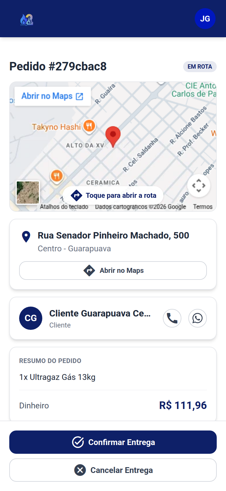
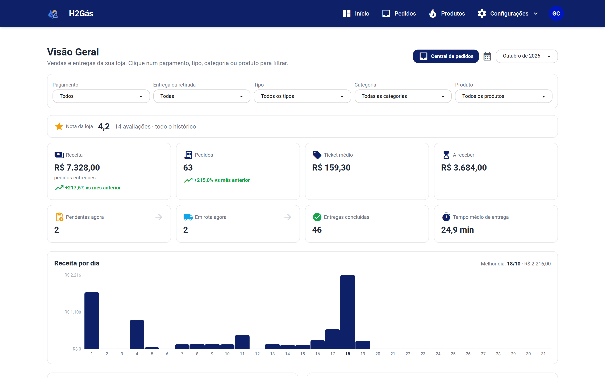

# H2Gás

### **Autor:** Igor Emanuel
### **Orientador:** Roni Fabio Banaszewski · **Coorientador:** Pablo de Paula Correia

O H2Gás é uma aplicação web (PWA) de pedidos e entregas de gás de cozinha (GLP) e água mineral. O cliente encontra
as lojas da sua cidade, compara preços e frete por distância, faz o pedido e acompanha a entrega em tempo real; a
loja gerencia pedidos, catálogo, entregadores e indicadores de venda; o entregador recebe as rotas e confirma as
entregas.

Trabalho de Conclusão de Curso de Tecnologia em Sistemas para Internet, UTFPR, Câmpus Guarapuava. A versão 2.0
evolui o MVP desenvolvido por Pablo de Paula Correia.

## 🖼️ Telas

| Vitrine do cliente | Entrega (entregador) |
|---|---|
|  |  |

**Pedidos recebidos (loja):** pedidos em tempo real, filtro por status, destaque de pedido parado e frete no detalhe.

**Painel da loja:** receita dos pedidos entregues, indicadores do mês e nota da loja.

## 📚 Documentação do Projeto

- [📄 Especificações (SDD)](./docs/sdd/) - Um script por funcionalidade (fundações F1–F12 e histórias HU01–HU29), com
  critérios de aceitação BDD, contrato técnico, plano de testes e definição de pronto.
- [🛠️ Processo de desenvolvimento](./CLAUDE.md) - Regras de SDD + TDD, convenções de código e da API.
- 📘 Documentação da API (Swagger) - `/h2gas-api/swagger-ui.html` no site em produção.

## 🌐 Site em Produção

https://h2gas.187.127.22.98.sslip.io

## 💻 Tecnologias e Dependências

- **Backend:** Java 17, Spring Boot 3.4, Spring Security (JWT), JPA/Hibernate, MySQL 9, Flyway, springdoc-openapi,
  Server-Sent Events e Web Push (VAPID).
- **Frontend:** Angular 19, Tailwind CSS 4 + DaisyUI 5, Leaflet e service worker (PWA).
- **Serviços:** Cloudinary (imagens), SMTP (e-mails e código de login) e Twilio (WhatsApp/SMS, opcional).
- **Infra:** Docker, GitHub Actions (testes em cada PR e imagens no GHCR a cada push na `main`) e Coolify.

## 🚀 Manual de execução

- Clonar o repositório com `git clone` (a branch `main` tem a versão mais recente).
- Copiar `.env.example` para `.env` na raiz e preencher as variáveis (banco, JWT, SMTP e Cloudinary; *push* e Twilio
  são opcionais).
- Subir o banco e o backend com Docker:
  - Comando: `docker compose up -d --build`
  - O Flyway cria o esquema; a API fica em `/h2gas/api` e o Swagger em `/h2gas/swagger-ui.html`.
- Executar o frontend:
  - Comando: `cd frontend && npm install && npm start`
  - Abre em `http://localhost:4200` (a URL da API fica em `frontend/src/environments/environment.ts`).
- Rodar os testes:
  - Backend: `cd backend && mvn test`
  - Frontend: `cd frontend && npx ng test --watch=false --browsers=ChromeHeadless`
